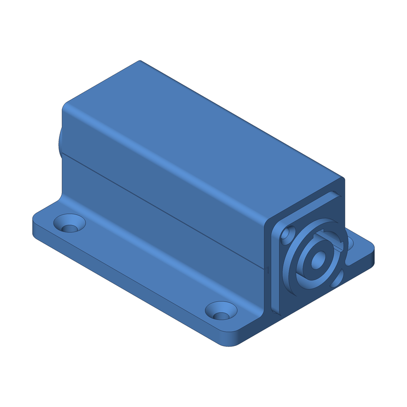

<div align="center">



# build123d starter

**Parametric, 3D-printable parts in Python.**

Write a model with [build123d](https://build123d.readthedocs.io), run `make`, get STL, STEP and OBJ files plus an isometric PNG preview.


</div>

---

Requires [uv](https://docs.astral.sh/uv/) and make.

```sh
make setup              # install deps into .venv (run once)
make                    # export example -> build/{stl,step,obj,png}/example.*
make MODEL=mypart       # export models/mypart.py
make stl MODEL=mypart   # export only if build/stl/mypart.stl is stale
make step MODEL=mypart  # export only if build/step/mypart.step is stale
make obj MODEL=mypart   # export only if build/obj/mypart.obj is stale
make png MODEL=mypart   # export only if build/png/mypart.png is stale
make all-models         # export every model in models/
make view MODEL=mypart  # export and show in the OCP viewer (needs it running)
make list               # list available models
make clean              # delete build/
make help               # show all targets
```

Outputs are grouped by type: `build/stl/`, `build/step/`, `build/obj/` and
`build/png/`, one file per model in each. One exporter run writes all four, so
`stl`, `step`, `obj` and `png` each rebuild everything when the model is out of
date.

Add a part by copying `models/example.py`; each model defines `build()`.
See `CLAUDE.md` for conventions (written for AI agents, useful for humans too).

To reuse as a template: copy this folder, delete `.git`, `build/` and `.venv/`, rename the project in `pyproject.toml`, and replace `models/example.py`.

## Terminals for the Neutrik powerCON connectors

The NAC3MPA-1 (blue, power-in) and NAC3MPB-1 (grey, power-out) chassis
connectors have three 3/16" FASTON tabs, 4.8 × 0.5 mm, and are rated 20 A
with 2.5 mm² wire. Buy receptacles to match that tab, not the more common
1/4" (6.3 mm) size:

- **Receptacle:** fully insulated *straight* female FASTON receptacle for a
  **4.8 × 0.5 mm** tab, **1.5–2.5 mm² (16–14 AWG)**, the blue-barrel size.
  Generic listings call this FDFD 2-187 or "4.8 mm blue fully insulated
  female disconnect". TE Connectivity's FASTON 187 Ultra-Fast fully
  insulated receptacle (e.g. 3-350816-2, 16–14 AWG, 0.187" × 0.020" tab) is
  the branded equivalent; confirm the tab thickness is 0.020" / 0.5 mm, since
  TE also sells 0.032" versions for thicker tabs. Fully insulated barrels
  only go up to 2.5 mm² at this tab size; 12–10 AWG receptacles exist only
  for 6.3 mm tabs, so use 2.5 mm² (14 AWG) stranded wire for the full 20 A.
- **Straight, not flag.** The plastic ribs around each tab extend past the
  tab tips, so a receptacle must leave the tab straight back before the wire
  turns. Flag (90°) receptacles will not seat.
- **Crimp tool:** a ratcheting crimper for insulated terminals with the
  standard red/blue/yellow dies. Use the blue die.
- **Wire:** 2.5 mm² / 14 AWG stranded, 105 °C, 300 V or better (H07V-K,
  MTW or TEW). Brown/blue/green-yellow (IEC) or black/white/green (US).

Count on three receptacles per connector: 12 for the 1-in 3-out distro box,
plus three 4-way lever connectors (Wago 221-415 or equal) if the distro is
star-wired. The in-line couplers are too short for receptacles (the two
connectors' tab tips face each other about 12 mm apart), so solder the wires
to their tabs instead. The wiring diagram is in
`docs/powercon_distro_wiring.html`. Mounting hardware per connector is two
M3 × 10 countersunk screws, self-tapping into the printed pilot holes; the
distro lid takes four M3 × 12 countersunk screws.

---

<p align="center">Built with ❤️ by <a href="https://x.com/aeksco">aeksco</a></p>
