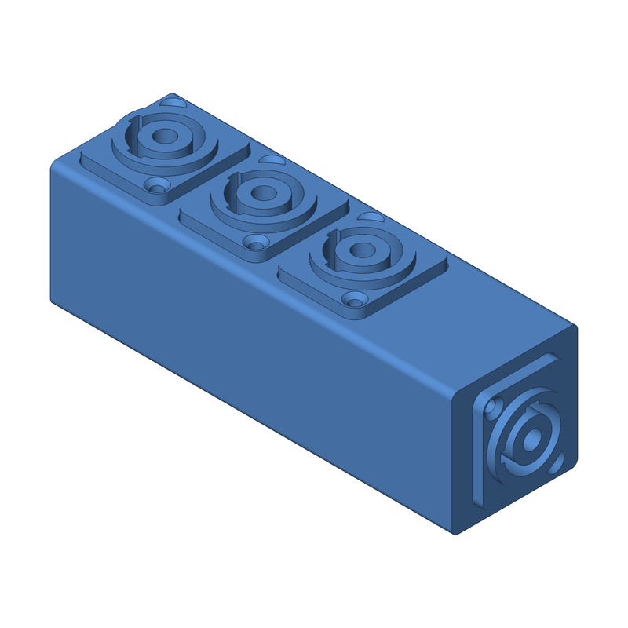
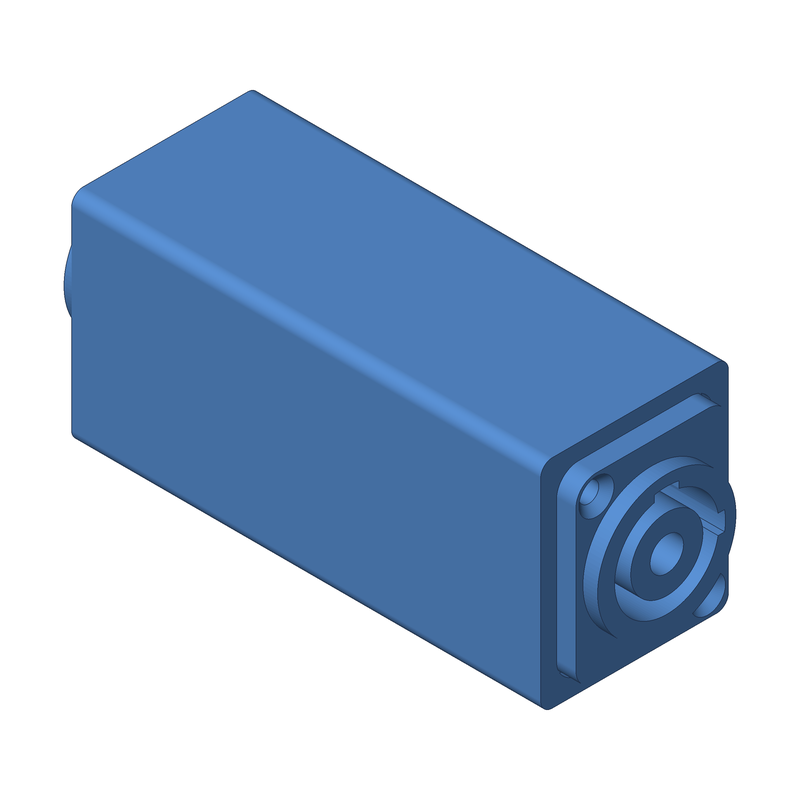
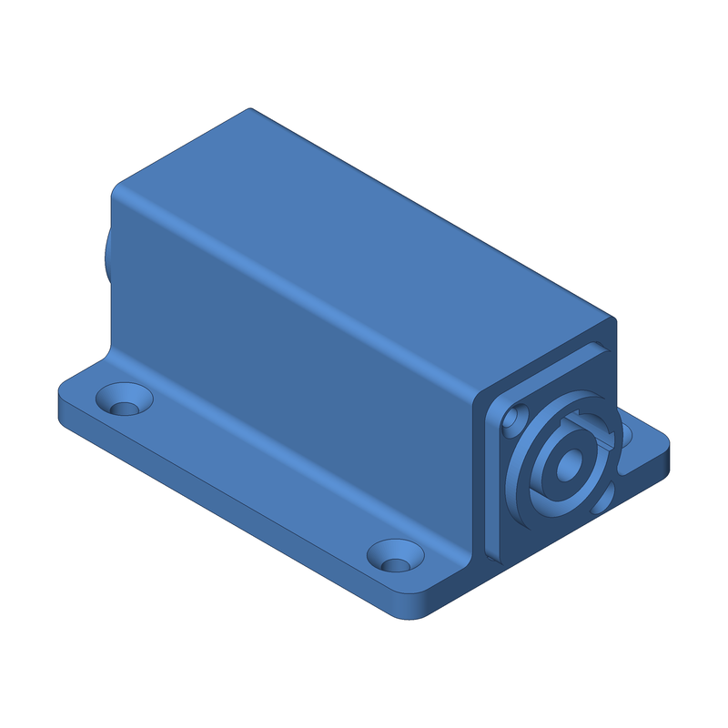
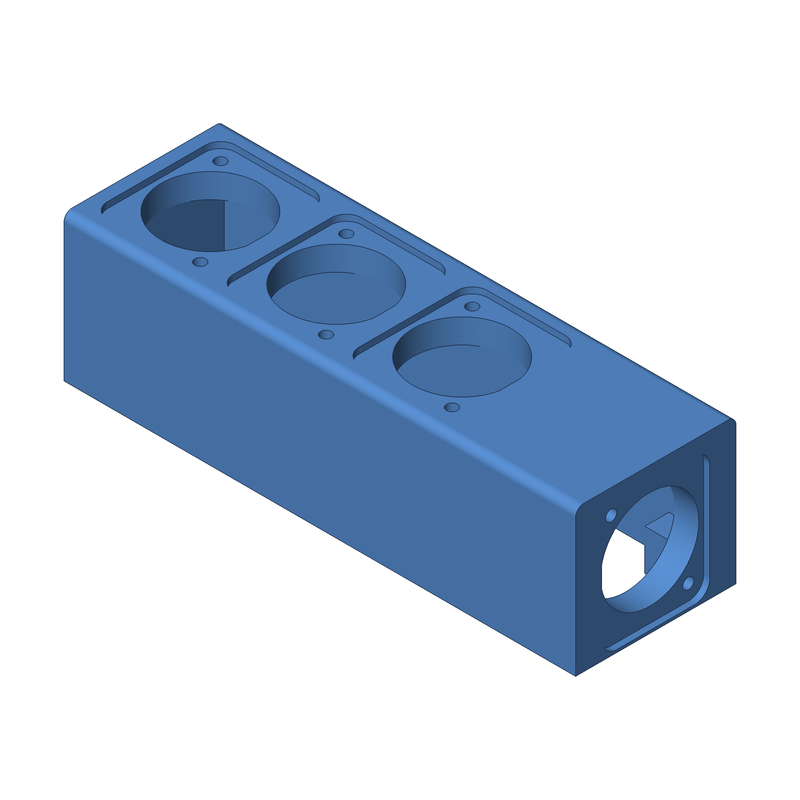
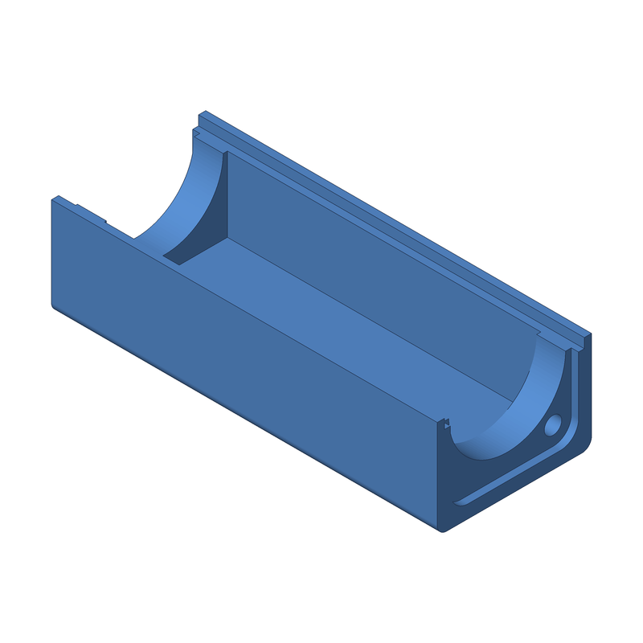
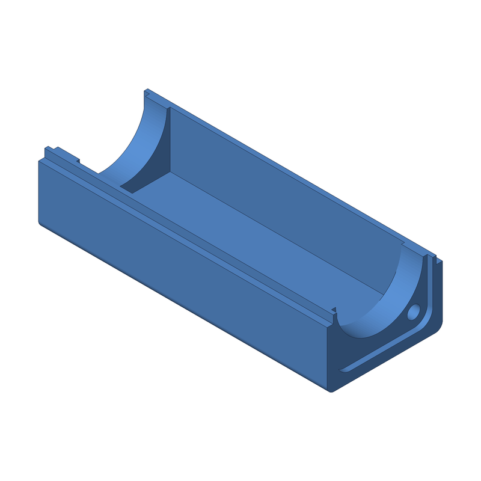
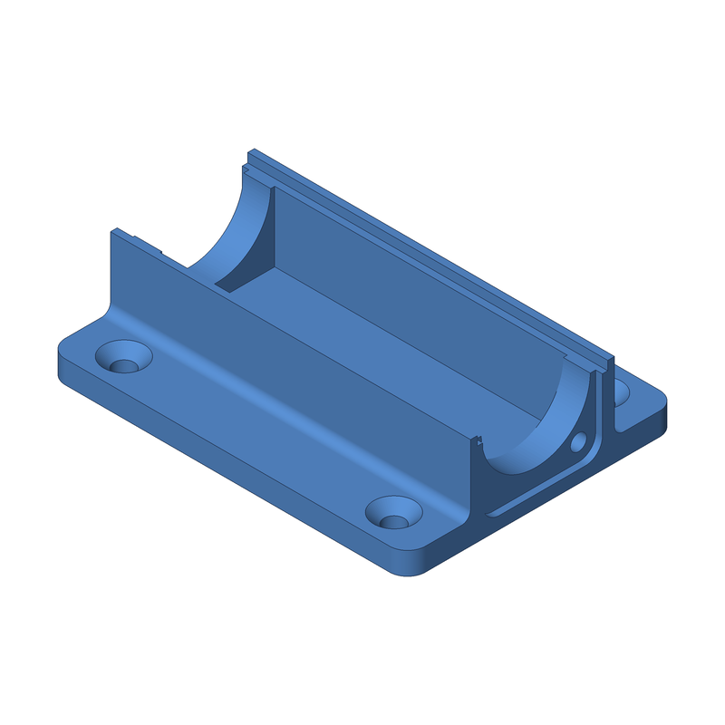

<div align="center">



# powerCON parts

**3D-printable housings for Neutrik powerCON connectors, modelled in Python.**

Parametric [build123d](https://build123d.readthedocs.io) models of the NAC3MPA-1 (blue, power-in) and NAC3MPB-1 (grey, power-out) chassis connectors, and printable couplers and a distro box designed around them. Run `make`, get STL, STEP and OBJ files plus an isometric PNG preview.


</div>

---

## Parts

| Model | What it is |
|---|---|
| `powercon_coupler` | In-line coupler, 80 mm long: blue power-in on one end, grey power-out on the other, one closed box. Lets a power-in cable feed a power-out cable. |
| `powercon_coupler_undermount` | The same coupler with a mounting plate and four countersunk holes, for screwing to the underside of a desk or table. |
| `powercon_coupler_split_bottom` + `powercon_coupler_split_top` | The coupler as two U-shaped halves that print open side up with no supports. The connector screws clamp the halves together and a lap joint along the side walls keeps them aligned. |
| `powercon_coupler_undermount_split_bottom` + `powercon_coupler_split_top` | Split version of the under-mount coupler. The plate half is new; the top half is the same part as the plain split coupler's. |
| `powercon_distro_1in_3out` + `powercon_distro_1in_3out_lid` | 1-in 3-out distro box: blue input on the end, three grey outputs along one long face, screw-on lid on the opposite face for wiring and service. |
| `m3_nut_cutter` | Filleted hex prism the size of an M3 nut. Use it as a negative volume in a slicer; it is also what the couplers subtract for their nut pockets. |
| `powercon_nac3mpa`, `powercon_nac3mpb` | The connectors themselves, dimensioned from Neutrik's drawings and STEP files. Reference geometry for fit checks, not for printing. |
| `*_assembly` | A housing with its connectors (and lid or top half) in place, for fit checks. |

<table align="center">
  <tr>
    <td align="center"><br>In-line coupler</td>
    <td align="center"><br>Under-mount coupler</td>
    <td align="center"><br>Distro box, lid off</td>
  </tr>
  <tr>
    <td align="center"><br>Split coupler, bottom half</td>
    <td align="center"><br>Split coupler, top half (print orientation)</td>
    <td align="center"><br>Split under-mount coupler, plate half</td>
  </tr>
</table>

Every part is modelled in print orientation, with the face that goes on the
bed on Z=0. The split halves and the distro lid print with no supports; the
one-piece couplers and the distro housing bridge the cavity ceiling
(26–34 mm), which most printers handle.

## Building

Requires [uv](https://docs.astral.sh/uv/) and make.

```sh
make setup                      # install deps into .venv (run once)
make                            # export powercon_coupler -> build/{stl,step,obj,png}/
make MODEL=powercon_distro_1in_3out   # export one model
make all-models                 # export every model in models/
make stl MODEL=<name>           # export only if build/stl/<name>.stl is stale (also step, obj, png)
make renders                    # refresh docs/renders/ (the PNGs shown above)
make view MODEL=<name>          # export and show in the OCP viewer (needs it running)
make list                       # list available models
make clean                      # delete build/
make help                       # show all targets
```

Outputs are grouped by type: `build/stl/` for slicers, `build/step/` for CAD,
`build/obj/` for mesh tools and `build/png/` for a quick visual check, one
file per model in each. One exporter run writes all four, so `stl`, `step`,
`obj` and `png` each rebuild everything when a model is out of date. Every
model depends on all of `models/*.py` and `lib/*.py`, so changing a housing
also rebuilds the assemblies and variants that import it.

Each model in `models/` defines `build()`; all dimensions are named constants
at the top of the file, in mm. The connector geometry and the D-size cutout
and flange recess live in `lib/powercon.py`. See `CLAUDE.md` for the
conventions (written for AI agents, useful for humans too).

## Hardware

- Connectors: Neutrik NAC3MPA-1 (blue, power-in) and NAC3MPB-1 (grey, power-out).
- Coupler connector screws: two M3 × 12 countersunk per connector, into M3
  hex nuts (5.5 mm across flats, 2.4 mm thick) glued with a drop of CA into
  the hex pockets on the inside of the end walls. M3 × 10 reaches under 2 mm
  into the nut. If the nuts don't fit your printer's pockets, adjust the
  constants in `models/m3_nut_cutter.py`.
- Distro connector screws: two M3 × 10 countersunk per connector, self-tapping
  into the printed 2.5 mm pilot holes. Lid: four M3 × 12 countersunk.
- Under-mount plate: four #8 / M4 flat-head wood screws.

## Terminals for the Neutrik powerCON connectors

The NAC3MPA-1 and NAC3MPB-1 have three 3/16" FASTON tabs, 4.8 × 0.5 mm, and
are rated 20 A with 2.5 mm² wire. Buy receptacles to match that tab, not the
more common 1/4" (6.3 mm) size:

- **Receptacle:** fully insulated *straight* female FASTON receptacle for a
  **4.8 × 0.5 mm** tab, **1.5–2.5 mm² (16–14 AWG)**, the blue-barrel size.
  Generic listings call this FDFD 2-187 or "4.8 mm blue fully insulated
  female disconnect". TE Connectivity's FASTON 187 Ultra-Fast fully
  insulated receptacle (e.g. 3-350816-2, 16–14 AWG, 0.187" × 0.020" tab) is
  the branded equivalent; confirm the tab thickness is 0.020" / 0.5 mm, since
  TE also sells 0.032" versions for thicker tabs. Fully insulated barrels
  only go up to 2.5 mm² at this tab size; 12–10 AWG receptacles exist only
  for 6.3 mm tabs, so use 2.5 mm² (14 AWG) stranded wire for the full 20 A.
- **Straight, not flag.** The plastic ribs around each tab extend past the
  tab tips, so a receptacle must leave the tab straight back before the wire
  turns. Flag (90°) receptacles will not seat.
- **Crimp tool:** a ratcheting crimper for insulated terminals with the
  standard red/blue/yellow dies. Use the blue die.
- **Wire:** 2.5 mm² / 14 AWG stranded, 105 °C, 300 V or better (H07V-K,
  MTW or TEW). Brown/blue/green-yellow (IEC) or black/white/green (US).

Count on three receptacles per connector: 12 for the 1-in 3-out distro box,
plus three 4-way lever connectors (Wago 221-415 or equal) if the distro is
star-wired. In the in-line couplers the two connectors' tab tips face each
other about 24 mm apart, so straight receptacles on both would meet head-on:
use receptacles on one connector (3 per coupler) and solder the wires to the
other, or solder both. The distro wiring diagram is in
`docs/powercon_distro_wiring.html`.

---

<p align="center">Built with ❤️ by <a href="https://x.com/aeksco">aeksco</a></p>
